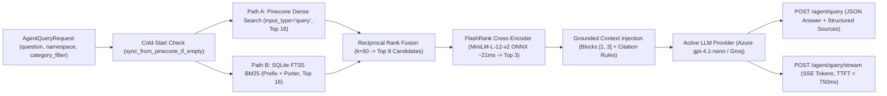

# Semantic ETL Pipeline & Grounded RAG Microservice

[](https://www.python.org/)
[](https://fastapi.tiangolo.com)
[](https://azure.microsoft.com/)
[-000000.svg)](https://www.pinecone.io/)
[-003B57.svg?logo=sqlite)](https://www.sqlite.org/fts5.html)
[](https://github.com/PrithivirajDamodaran/FlashRank)
[](benchmarks/test_suite.py)

A containerized, multi-modal **Semantic ETL Pipeline & Grounded RAG Microservice** built with FastAPI. It converts complex PDFs (text, Markdown tables, and technical diagrams) into dual-indexed semantic + lexical stores, then serves citation-grounded answers using **Dual-Path Hybrid Retrieval (Pinecone + SQLite FTS5)**, **Reciprocal Rank Fusion (RRF)**, **local ONNX FlashRank cross-encoder reranking**, and **Server-Sent Events (SSE) streaming**.

---

## How the System Works (Data Flow)

The service is split into two pipelines connected by strict Pydantic data contracts ([`src/models.py`](src/models.py)) and backed by persistent SQLite WAL storage ([`data/jobs.db`](src/jobs.py) & [`data/lexical_index.db`](src/loading/lexical_store.py)).

### 1. Ingestion Data Flow (Extract → Transform → Load)

```mermaid
flowchart LR
    In["PDF Input (file_path or UploadFile)"] --> Jobs["JobManager (SQLite WAL: data/jobs.db, HTTP 202)"]
    In --> Parse["PDFParserEngine (Docling v2, 1.5x scale)"]

    Parse -->|"Text & Headers"| Elems["List[ExtractedElement]"]
    Parse -->|"TableItem -> Markdown Grid"| Elems
    Parse -->|"PictureItem >=75px & AR<=8"| Cache["Cached PNGs (data/cache/)"]

    Cache --> Vision["MultimodalVisionEngine (Azure/Groq VLM, Semaphore=10)"]
    Vision -->|"Replaces image ref with text summary"| Elems

    Elems --> Chunker["SemanticChunker (semchunk + Atomic Tables, <=1200 chars)"]
    Chunker -->|"List[List[ExtractedElement]]"| Enricher["ChunkEnricher (Parallel LLM JSON -> ChunkMetadata)"]

    Enricher --> Builder["VectorDatabaseClient.build_payload (MD5 ID + Passage Embedding)"]
    Builder -->|"FinalVectorPayload[] (1024-d, input_type='passage')"| Pinecone[("Pinecone Serverless (Dense Vectors)")]
    Builder -->|"Text + search_tokens + metadata"| FTS5[("SQLite FTS5 (BM25 + Porter Stemmer)")]
```



### 2. Query & Grounded RAG Data Flow



### Inter-Stage Data Contracts ([`src/models.py`](src/models.py))

| Stage | Module / Class | Input | Output |
|---|---|---|---|
| **Extract (Layout)** | [`PDFParserEngine`](src/extraction/doc_parser.py) | `file_path: str` | `List[ExtractedElement]` + filtered diagram PNGs in `data/cache/` |
| **Extract (Vision)** | [`MultimodalVisionEngine`](src/extraction/vision.py) | `Image` elements (`image_cache_path`) | Updates `el.content` in place with `[Visual Image Summary]: ...` |
| **Transform (Chunk)** | [`SemanticChunker`](src/transformation/chunker.py) | `List[ExtractedElement]` | `List[List[ExtractedElement]]` (atomic tables, header breaks, `semchunk` prose splits) |
| **Transform (Enrich)** | [`ChunkEnricher`](src/transformation/enricher.py) | Semantic windows + `parent_id` UUID | `List[ChunkMetadata]` (`summary`, `keywords`, `category`, `parent_context_id`) |
| **Load (Dual Store)** | [`VectorDatabaseClient`](src/loading/vector_db.py) & [`LexicalStore`](src/loading/lexical_store.py) | `(Window, ChunkMetadata)` | `List[FinalVectorPayload]` (MD5 ID, 1024-d vector, `search_tokens`) → **Pinecone** + **SQLite FTS5** |
| **Retrieve & Rerank** | [`ContextRetriever`](src/agents/retriever.py) → [`reciprocal_rank_fusion`](src/agents/fusion.py) → [`ContextReranker`](src/agents/reranker.py) | `question`, `namespace`, `category_filter` | Top-3 reranked context blocks scored locally via ONNX FlashRank |
| **Synthesize** | [`SemanticRAGAgent`](src/agents/core.py) | Top-3 context blocks + user question | Grounded answer with bracketed `[1]`, `[2]` citations & source metadata (or SSE stream) |

---

## Key Engineering Features

- **Layout-Aware Semantic Chunking (`semchunk`)**: Preserves Markdown tables as atomic units and triggers clean breaks on headers and large tables with sliding element overlap (`OVERLAP_ELEMENTS=1`), eliminating broken tables.
- **Asymmetric Dense + Sparse Hybrid Search via RRF**: Enforces `input_type="passage"` during indexing and `input_type="query"` during retrieval on `llama-text-embed-v2`, then merges Pinecone dense hits with SQLite FTS5 BM25 hits (`porter unicode61`) using Reciprocal Rank Fusion (`k=60`).
- **Sub-30ms Local Cross-Encoder Reranking**: Replaces brittle, rate-limited generative LLM listwise reranking (~46.2s) with local CPU ONNX **FlashRank** (`ms-marco-MiniLM-L-12-v2`, ~21ms inference, zero token cost). See [`benchmarks/reranker_investigation.md`](benchmarks/reranker_investigation.md) for the full debugging postmortem.
- **Pluggable LLM Provider Factory**: Abstracts chat completions, streaming, vision captioning, and JSON enrichment behind [`BaseLLMProvider`](src/providers/base.py), supporting **Azure AI Foundry** (`gpt-4.1-nano`) and **Groq** (`qwen/qwen3.6-27b` / `openai/gpt-oss-120b`).
- **Crash-Safe Background Jobs (`HTTP 202`)**: Long-running ingestion jobs persist state (`queued | processing | completed | failed`) in SQLite WAL mode ([`data/jobs.db`](src/jobs.py)), surviving server restarts alongside automatic cache garbage collection ([`clean_cache_directory`](src/utils/cache_cleaner.py)).

---

## Empirical Benchmarks

Evaluated via the 5-suite harness in [`benchmarks/`](benchmarks/) (full outputs in [`benchmarks/results.md`](benchmarks/results.md) and [`benchmarks/results.json`](benchmarks/results.json)).

### 1. Chunking Quality (Layout-Aware Semantic vs. Naive 1200-Char Fixed Baseline)

| Metric | Semantic Chunker | Naive Fixed Chunker | Measured Delta |
|---|---|---|---|
| **Boundary Preservation** | **100.0%** (`0` fractures) | `7.69%` (`12` fractures) | **Zero broken tables/headers** |
| **Downstream MRR** | **0.4000** | `0.1476` | **+171.0% Lift** |
| **Downstream Recall @ 3** | **0.40** | `0.20` | **+100.0% Lift** |
| **Downstream Recall @ 5** | **0.60** | `0.30` | **+100.0% Lift** |
| **Downstream NDCG @ 5** | **0.4521** | `0.2104` | **+114.88% Lift** |

### 2. Retrieval Ablation (25 Ground-Truth Queries in `benchmark-eval-sandbox`)

| Configuration | Recall @ 1 | Recall @ 3 | Recall @ 5 | Precision @ 3 | MRR | NDCG @ 5 | Latency p50 |
|---|---|---|---|---|---|---|---|
| **Dense Vector-Only** (`Pinecone 1024-d`) | 0.16 | 0.24 | 0.24 | 0.1333 | 0.2107 | 0.1800 | `386.83ms` |
| **Lexical BM25-Only** (`SQLite FTS5`) | 0.16 | 0.20 | 0.20 | **0.1734** | 0.1907 | 0.2082 | **`2.25ms`** |
| **Hybrid RRF** (`Dense + BM25`, no rerank) | 0.16 | 0.20 | **0.40** | 0.1333 | **0.2260** | **0.2164** | `155.85ms` |
| **Full Hybrid + FlashRank Cross-Encoder** | 0.16 | 0.20 | **0.36** | 0.1333 | **0.2197** | 0.2074 | `972.68ms` |

- **Hybrid + FlashRank vs. Dense-Only:** **+50.0% Recall@5 lift** (`0.24 → 0.36`) and **+4.27% MRR lift** (`0.2107 → 0.2197`), while cutting reranking E2E latency **47.5x** compared to the legacy generative LLM reranker (`46,223ms → 972.68ms` E2E; `~21ms` FlashRank ONNX step).

### 3. Enrichment, Ingestion & API Concurrency

- **AI Metadata Enrichment:** **100.0%** `ChunkMetadata` Pydantic conformance and **100.0%** category agreement at **`909.31ms` p50** (`1.86s` batch for 11 chunks vs `60.20s` serial Groq = **32.4x speedup**).
- **API Concurrency (`/agent/query`):** **100.0%** request success across `c=1, 5, 10` (`4938.5ms` p50 at `c=1`, peak `0.35 RPS` at `c=5`, `1.81x` p50 degradation at `c=10`).
- **SSE Streaming (`/agent/query/stream`):** **< 750ms** Time-to-First-Token (TTFT).

---

## Repository Structure

```text
Semantic-ETL-Pipeline/
├── .env.example                      # Environment blueprint (Azure, Pinecone, Groq, chunking)
├── Dockerfile                        # Multi-stage slim image (CPU-only PyTorch)
├── docker-compose.yml                # Service orchestration with live ./src reload & ./data mount
├── requirements.txt                  # Python dependencies
├── init_db.py                        # Provisions Pinecone serverless index (1024-d, cosine)
├── add_data.py                       # Mocked-parser E2E ETL smoke test script
├── run_agent_query.py                # CLI smoke test for Hybrid RAG + source citations
│
├── src/
│   ├── main.py                       # FastAPI app, REST endpoints & SSE streaming
│   ├── config.py                     # Pydantic BaseSettings singleton (settings)
│   ├── models.py                     # ExtractedElement, ChunkMetadata, FinalVectorPayload
│   ├── jobs.py                       # SQLite WAL persistent JobManager (HTTP 202 tracking)
│   ├── providers/                    # Base interfaces, factory, Azure, Groq & Pinecone clients
│   ├── extraction/
│   │   ├── doc_parser.py             # Docling PDF layout/table parser & image noise filter
│   │   └── vision.py                 # Concurrent multimodal VLM image captioning
│   ├── transformation/
│   │   ├── chunker.py                # Layout-aware semchunk windowing with element overlap
│   │   └── enricher.py               # Semaphore-bounded async Pydantic metadata enricher
│   ├── loading/
│   │   ├── vector_db.py              # Payload builder, MD5 hashing & Pinecone upsert/sync
│   │   └── lexical_store.py          # SQLite FTS5 BM25 inverted index & cold-start sync
│   ├── agents/
│   │   ├── core.py                   # SemanticRAGAgent (grounded prompts, sync & SSE)
│   │   ├── retriever.py              # Dual-path Dense + BM25 context retriever
│   │   ├── fusion.py                 # Reciprocal Rank Fusion (RRF k=60)
│   │   └── reranker.py               # FlashRank local ONNX cross-encoder singleton
│   └── utils/
│       ├── logger.py                 # Structured JSON stdout logger
│       └── cache_cleaner.py          # Age-based cache garbage collector
│
├── benchmarks/
│   ├── test_suite.py                 # 8 offline pytest unit & persistence tests
│   ├── run_benchmark.py              # CLI runner for the 5 benchmark suites
│   ├── config.py                     # BenchmarkConfig parameters
│   ├── dataset.py                    # 25 ground-truth queries & labeled enrichment samples
│   ├── baselines.py                  # NaiveFixedChunker & BaselineRetrievalEvaluator
│   ├── metrics.py                    # MRR, Recall@K, Precision@K, NDCG@K, percentiles
│   ├── reporter.py                   # Automated Markdown & JSON report compiler
│   ├── reranker_investigation.md     # Root-cause postmortem on early reranker regressions
│   ├── results.md                    # Latest generated Markdown benchmark report
│   ├── results.json                  # Latest raw JSON benchmark metrics
│   └── runners/                      # Ingestion, chunking, retrieval, load & enrichment runners
│
└── data/                             # Persistent runtime storage (mounted in Docker)
    ├── 01.pdf / 02.pdf               # Sample technical PDFs
    ├── jobs.db                       # SQLite WAL background job state
    ├── lexical_index.db              # SQLite FTS5 BM25 index
    └── cache/                        # Extracted diagrams & FlashRank ONNX cache
```

---

## Quickstart

### 1. Configure Environment & Vector Index

Copy [`.env.example`](.env.example) to `.env` and add your credentials:

```bash
cp .env.example .env
```

Key variables in `.env`:
```env
PINECONE_API_KEY=your_pinecone_api_key_here
PINECONE_INDEX_NAME=semantic-etl-index

# Primary LLM & Vision (Azure AI Foundry)
AZURE_API_KEY=your_azure_api_key_here
AZURE_OPENAI_ENDPOINT=https://your-resource.services.ai.azure.com/openai/v1
AZURE_MODEL_NAME=gpt-4.1-nano

# Optional Fallback (Groq)
GROQ_API_KEY=your_groq_api_key_here
```

### 2. Local Development

```bash
# Create and activate virtual environment
python -m venv .venv
source .venv/bin/activate       # Linux/macOS
.venv\Scripts\activate          # Windows

# Install dependencies
pip install -r requirements.txt

# Provision the 1024-dim Pinecone index (first-time setup)
python init_db.py

# Run offline verification tests (no API keys required)
pytest -v benchmarks/test_suite.py

# Start FastAPI server
uvicorn src.main:app --host 0.0.0.0 --port 8000 --reload
```

### 3. Docker Deployment

```bash
docker compose up --build -d
curl http://localhost:8000/health
```

---

## REST API Reference

| Method & Path | Purpose | Behavior |
|---|---|---|
| `GET /health` | Service & provider readiness | Reports Pinecone, Azure, Groq config & active providers |
| `POST /pipeline/run` | Ingest local/mounted PDF path | Synchronous E2E ETL execution |
| `POST /pipeline/upload` | Upload & ingest PDF (`multipart/form-data`) | Synchronous ETL execution with temp file cleanup |
| `POST /pipeline/jobs/run` | Queue local/mounted PDF path | Non-blocking; returns `HTTP 202` + `JobRecord` |
| `POST /pipeline/jobs/upload` | Queue uploaded PDF | Non-blocking; returns `HTTP 202` + `JobRecord` |
| `GET /pipeline/jobs/{job_id}` | Poll job progress & result | Reads persistent SQLite `jobs.db` |
| `GET /pipeline/jobs` | List recent jobs | Returns latest `JobRecord` entries |
| `POST /agent/query` | Ask grounded question | Returns `answer` with `[1]` citations + `sources` metadata |
| `POST /agent/query/stream` | Ask grounded question (streaming) | Streams `text/event-stream` (`data: {"token": "..."}`) |

### Example Query Request

```bash
curl -X POST "http://localhost:8000/agent/query" \
  -H "Content-Type: application/json" \
  -d '{
    "question": "What is the difference between unit testing and integration testing in the test pyramid?",
    "namespace": "documents"
  }'
```

---

## Testing & Benchmarking

```bash
# 1. Offline unit & SQLite persistence tests (8 tests)
pytest -v benchmarks/test_suite.py

# 2. Live 5-suite empirical benchmarks
python -m benchmarks.run_benchmark --all

# 3. Targeted suite runs
python -m benchmarks.run_benchmark --suite retrieval --fast
python -m benchmarks.run_benchmark --suite enrichment --enrichment-samples 5
python -m benchmarks.run_benchmark --suite load --concurrency 1,5,10
```

---

## License

MIT License.
